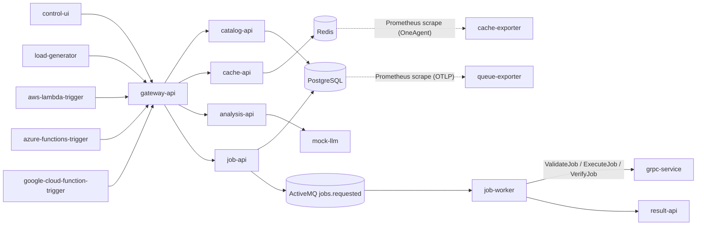

# Observability Demo

Observability Demo is a small Kubernetes workload for exploring observability in a distributed system. It generates connected HTTP, database, Redis, messaging, gRPC, simulated FaaS, AI, service-map, and memory-profiling signals using OneAgent, OpenTelemetry, and ActiveGate-scraped Prometheus metrics.

## Architecture



The control UI submits an asynchronous job, queries catalog data, calls Redis, calls the optional AI path, applies deterministic failure scenarios, and edits layered resource attributes for a private demo environment. It does not imitate a company or business process.


The screenshot shows the live control surface with background load, manual request controls, failure scenarios, and resource-attribute editing (captured before the rename).

## Run it

Prerequisites: Docker, `kubectl`, `helm`, `istioctl`, and `envsubst`. Builds and tests run in containers; local Node, Go, Java, and Python packages are not required.

```bash
cp .env.example .env
make verify
make k3s-deploy
make app-url
```

For an existing Istio and Dynatrace Operator installation:

```bash
kubectl apply -f https://raw.githubusercontent.com/tristanmarl/obs-demo/main/deploy/dist/obs-demo.yaml
```

For a full setup, provide an environment Access Token and run `setup.sh`. The script uses the canonical app manifest and a stable Dynatrace Operator release.

## Prometheus scraping

`cache-exporter` (Go, OneAgent) and `queue-exporter` (Python, OTLP) expose Prometheus metrics scraped by the Dynatrace ActiveGate. Both emit identical control metrics so the two Dynatrace ingest paths can be compared in a single DQL query by `variant`. See `docs/telemetry.md` for the metric contract and `make enable-prometheus-scraping` for the two prerequisites.

## Host monitoring

An optional chain runs on the k3s EC2 host itself: `obs-edge-agent` (systemd) submits jobs through the Istio ingress, `result-api` writes to a MariaDB on the host, and a Dynatrace OTel Collector reports `otel:host` and `otel:process` entities. Run `make host-monitoring` on the host; see `docs/host-monitoring.md`.

## Controls

Failure scenarios are deterministic and backend-derived. Applying one resets all targets before enabling it. **Resource attributes** are layered (global, preset, team, workload) from `config/attributes.yaml`, editable in the UI or applied with `make attributes` (`make attributes PREVIEW=1` shows the diff first). The gateway validates them and patches only the explicit application/data allowlist, restarting just the workloads whose effective attributes changed. Set `DEMO_CONTROLS_ENABLED=false` before exposing ingress publicly; these private-demo controls intentionally have no production authentication.

```bash
make reset
./scripts/reset-demo.sh
```

Normal load includes a configurable background error rate (`LOADGEN_ERROR_RATE`, default `0.05`). Failures rotate through cache 500s, missing catalog items, and invalid jobs; targeted scenarios remain available for dependency and infrastructure failures.

## Configuration

Important defaults are in `.env.example`: `LOADGEN_DELAY_MS`, `LOADGEN_ERROR_RATE`, `MEMORY_PRESSURE_MB`, `MEMORY_SURVIVOR_BATCHES`, `FAAS_VERSION`, and `DEMO_CONTROLS_ENABLED`. The Java allocation scenario accepts 1–32 MB per batch and retains at most 1–16 batches.

## Verification

```bash
make verify
```

The target checks shell syntax, resource-attribute layering and validation tests, Python syntax, Go tests, the UI build, the bounded Java test, the gRPC contract check, every service image, stale vocabulary/secrets, and reproducible manifest rendering with no unresolved placeholders. When a cluster is available:

```bash
make k3s-load-images
IMAGE_REGISTRY=obs-demo IMAGE_TAG=dev ./scripts/deploy-demo.sh
kubectl -n obs-demo get pods
kubectl -n obs-demo-data get pods
```
