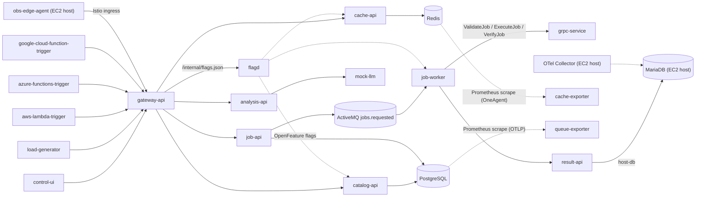
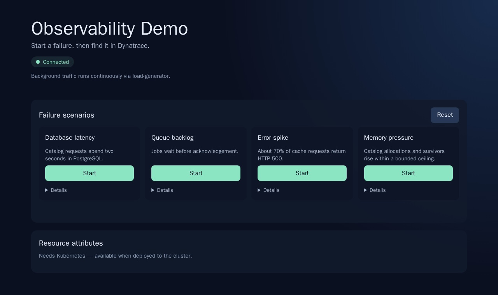

# Observability Demo

A small Kubernetes workload for exploring observability in a distributed system on a single EC2 k3s host. It generates connected HTTP, PostgreSQL, Redis, ActiveMQ, gRPC, simulated FaaS, GenAI, service-map and JVM-memory signals, and shows four ingest paths side by side:

- **OneAgent** (Dynatrace Operator injection) on Java, Go, Node and nginx workloads
- **OpenTelemetry** over OTLP (automatic exporter configuration) on the Python workloads
- **Prometheus metrics scraped by ActiveGate** through Istio's merged endpoint (`cache-exporter` via OneAgent, `queue-exporter` via OTLP)
- **Istio** sidecar traces and request metrics, plus an optional **EC2 host chain** (OTel Collector, host MariaDB, `obs-edge-agent`) for `otel:host` and `otel:process` entities

It does not imitate a company or business process. Controls are for a private demo; there is no production authentication.

## Architecture



More detail: [docs/architecture.md](docs/architecture.md), [docs/telemetry.md](docs/telemetry.md), [docs/istio-unified-services.md](docs/istio-unified-services.md).



*Captured from local Docker mode (`make run-local`). On a cluster the scenario cards show live state and the resource-attributes editor is available.*

## Quick start (single EC2 k3s host)

Prerequisites: Docker, `kubectl`, `istioctl`, `envsubst` (gettext-base) and `helm`. Builds and tests run in containers; no host Node, Go, Java or Python packages are needed.

```bash
cp .env.example .env     # set DT_TENANT_URL, DT_API_TOKEN (environment access token)
make verify              # tests, image builds, manifest render check
make k3s-deploy          # build, load into k3s, install Istio, deploy
make install-dynatrace   # Dynatrace Operator + DynaKube, if not installed yet
make app-url             # Istio ingress
```

Alternatives: `setup.sh` installs Istio, the Dynatrace Operator and the app in one go; for an existing Istio and Operator install, `kubectl apply -f https://raw.githubusercontent.com/tristanmarl/obs-demo/main/deploy/dist/obs-demo.yaml` and then `make attributes`.

## Configuration

- **Resource attributes** live in `config/attributes.yaml` as layers: `global`, `presets` (one active), `teams`, `workloads`; precedence is global, preset, team, workload. Edit the file and run `make attributes` (`make attributes PREVIEW=1` shows the per-workload diff first) or edit them in the control UI. Only workloads whose effective set changed are patched (and restarted): `OTEL_RESOURCE_ATTRIBUTES`, `metadata.dynatrace.com/<key>` pod annotations and, for OneAgent workloads, `DT_CUSTOM_PROP`. Details and Dynatrace caveats: [docs/telemetry.md](docs/telemetry.md).
- **`.env`** (see `.env.example`): `DT_TENANT_URL`, `DT_API_TOKEN`, `DT_DATA_INGEST_TOKEN`, `DT_OTEL_INGEST_TOKEN` (host collector), `K8S_CLUSTER_NAME`, `DYNAKUBE_NAME`, image registry/tag, load-generator and memory-pressure settings, `DEMO_CONTROLS_ENABLED`, and optional `HOST_DB_IP` / `INGRESS_URL`. Optional Adaptive Traffic Management sampler for Istio: `DT_PLATFORM_TOKEN` (scope `adaptive-traffic-management:sampling-configuration:read`), `DT_TENANT_ID`, `DT_CLUSTER_ID`; all three must be set, and the token is then stored in the Istio mesh config.
- **Optional deployment events**: a Secret `obs-demo-dt-events` with `DT_EVENTS_URL` and `DT_EVENTS_TOKEN` makes attribute applies post `CUSTOM_DEPLOYMENT` events.
- Never commit `.env`, tokens, tenant URLs or kubeconfigs.

## Scenarios

Four scenarios (database latency, queue backlog, error spike, memory pressure) are boolean OpenFeature flags served by `flagd`; the control UI, `POST /api/scenarios/{id}` and `make reset` change the flag ConfigMap, so switching is instant and restarts nothing. Services evaluate flags per request, default to stable on any error, and record evaluations on spans where the runtime supports it. In the control UI each card has one Start/Stop button and a collapsed **Details** section with the signal, target and where to look in Dynatrace; the global resource attributes are one editable list, with presets, teams and per-workload overrides under **Advanced**. There are no manual request buttons because `load-generator` already sends the same traffic. Runbooks: [docs/demo-scenarios.md](docs/demo-scenarios.md).

```bash
make reset    # all flags off; works with gateway-api down
```

Set `DEMO_CONTROLS_ENABLED=false` before exposing the ingress publicly: mutation routes then return 404 and the UI hides the controls. Background load includes an error rate (`LOADGEN_ERROR_RATE`, default `0.05`).

## Host monitoring (optional)

`make host-monitoring` on the k3s EC2 host installs MariaDB, a Dynatrace OTel Collector and the `obs-edge-agent` systemd unit. A trace then starts in a host process, crosses the Istio ingress and ends with `result-api` writing to the host database, and `otel:host` / `otel:process` entities appear. See [docs/host-monitoring.md](docs/host-monitoring.md).

## Dynatrace prerequisites

- Dynatrace Operator with a DynaKube (`make install-dynatrace`); application monitoring with OneAgent injection and OTLP exporter auto-configuration.
- Tenant: enable **Monitor annotated Prometheus exporters** (Kubernetes settings) and an in-cluster ActiveGate with `kubernetes-monitoring`; `make enable-prometheus-scraping` checks the rest.
- Tenant: review the **Monitor Envoy** toggle so Envoy is not monitored twice (pods opt the sidecar out of injection with `container.inject.dynatrace.com/istio-proxy: "false"`).
- Host chain: the **OpenTelemetry Host Monitoring** extension from Hub and a token with `metrics.ingest`, `logs.ingest`, `openTelemetryTrace.ingest`.
- The environment access token for `DT_API_TOKEN` needs `DataExport`, `activeGateTokenManagement.create` and `InstallerDownload` (see `scripts/apply-dynakube.sh`); the optional Istio sampler needs the platform token scope above.

## Verification

```bash
make verify
```

Checks shell syntax, gateway tests (attribute layering and validation, flag state, manifest sanity), the UI build, Go tests, Python syntax and unit tests (resource precedence, flag evaluation), the Java test, the gRPC contract test, every service image, and that `deploy/dist/obs-demo.yaml` renders reproducibly without unresolved placeholders. With a cluster: `make status`, then `kubectl -n obs-demo get pods`.

## Limitations

- Nothing here was verified against a live tenant by the test suite: enrichment of non-`dt.*` annotation keys, `DT_CUSTOM_PROP`, the Istio sampler and metric filter, and `feature_flag` span events depend on your Dynatrace setup.
- `cache-api` (Go) has no OTel SDK, so its flag hook only records when OneAgent supplies a span.
- One host only: every container has resource requests (about 735m CPU and 2 GiB memory in total, excluding Istio sidecars, Dynatrace components and k3s itself) and memory limits, with no HA.
- Controls have no authentication; re-applying the dist manifest resets scenario flags and attribute layers to the seeded defaults.
- The Python services that use OpenFeature run OpenTelemetry 1.45 while the others stay on 1.35, because the flagd provider requires newer protobuf.
- MariaDB emits no spans, so the host database link in Dynatrace is by timing and context rather than a drawn edge.
