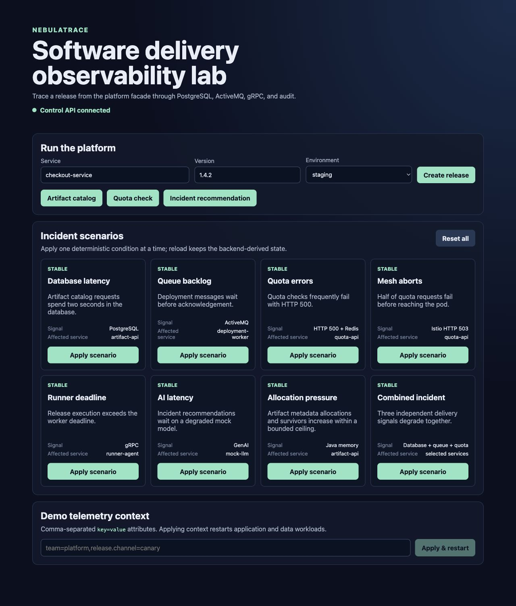
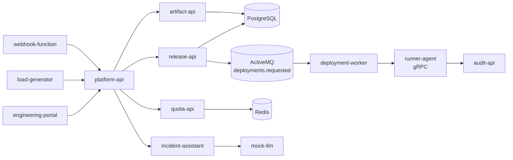

# NebulaTrace

NebulaTrace is a Kubernetes software-delivery observability lab for Dynatrace. A release request crosses OneAgent- and OpenTelemetry-instrumented services, PostgreSQL, Redis, ActiveMQ, Istio, gRPC, a simulated FaaS webhook, and an optional incident assistant.

The main trace is:

```text
engineering-portal / load-generator / webhook-function -> platform-api
platform-api -> release-api -> PostgreSQL -> ActiveMQ deployments.requested
deployment-worker -> runner-agent (gRPC) -> audit-api
platform-api -> artifact-api -> PostgreSQL
platform-api -> quota-api -> Redis
platform-api -> incident-assistant -> mock-llm
```

## Dashboard

The engineering portal puts release execution, deterministic incident scenarios, and demo telemetry context in one view.



## Architecture



## Run it

Prerequisites: Docker, `kubectl`, `helm`, `istioctl`, and `envsubst`. Builds and tests run in containers; local Node, Go, Java, and Python packages are not required.

```bash
cp .env.example .env
make verify
make k3s-deploy
make app-url
```

For an existing Istio and Dynatrace Operator installation:

```bash
kubectl apply -f https://raw.githubusercontent.com/tristanmarl/nebulatrace/main/deploy/dist/nebulatrace.yaml
```

For a full setup, provide an environment Access Token (`dt0c01.*`) and run `setup.sh`. The script uses the canonical app manifest and a stable Dynatrace Operator release.

## Controls

The portal supports release creation, artifact and quota checks, incident recommendations, eight deterministic incident scenarios, and **Demo telemetry context**. Applying telemetry context restarts the explicitly allowlisted application and data workloads. These mutation controls are for a private demo environment; set `DEMO_CONTROLS_ENABLED=false` before exposing the ingress publicly. This refactor does not add authentication.

```bash
make reset
./scripts/reset-demo.sh
```

The baseline keeps a configurable low error rate (`LOADGEN_ERROR_RATE`, default `0.02`) so normal traffic has visible failure telemetry without masking scenarios.

## Configuration

Important defaults are in `.env.example`: `LOADGEN_DELAY_MS`, `LOADGEN_ERROR_RATE`, `MEMORY_PRESSURE_MB`, `MEMORY_SURVIVOR_BATCHES`, `FAAS_PROVIDER`, `FAAS_VERSION`, and `DEMO_CONTROLS_ENABLED`. The Java allocation scenario accepts 1–32 MB per batch and retains at most 1–16 batches.

## Verification

```bash
make verify
```

The target checks shell syntax, Node resource-attribute validation, Python syntax, Go tests, the portal build, the bounded Java test through its Maven image build, every service image, and reproducible manifest rendering with no unresolved placeholders. When a cluster is available:

```bash
make k3s-load-images
IMAGE_REGISTRY=nebulatrace IMAGE_TAG=dev ./scripts/deploy-demo.sh
kubectl -n nebulatrace get pods
kubectl -n nebulatrace-data get pods
```
