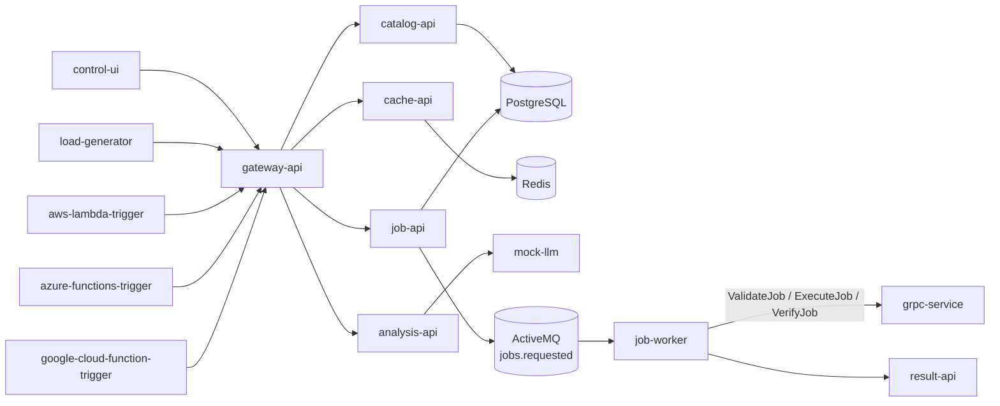

# Architecture

NebulaTrace is a neutral distributed-systems workload. Its boundaries make HTTP, PostgreSQL, Redis, ActiveMQ, gRPC, simulated FaaS, GenAI, and JVM memory signals visible without inventing a product or business story.

`job-api` validates `{name, workUnits}`, persists a UUID-derived job, and publishes minimal JSON with W3C context in STOMP headers. `job-worker` explicitly receives a frame, creates a `receive jobs.requested` span, then creates a separate `process jobs.requested` span. It calls `ValidateJob`, `ExecuteJob`, and `VerifyJob`, updates PostgreSQL, calls `result-api`, and ACKs only after the required work succeeds.

`catalog-api` reads PostgreSQL list/detail rows and can add database latency or bounded allocation pressure. `cache-api` reads and increments a real Redis key. The analysis path is optional and calls the local mock model without recording prompt or response bodies. The three provider trigger deployments share one image and submit ordinary jobs through the gateway.

The `nebulatrace` namespace contains application workloads and Istio sidecars. `nebulatrace-data` contains PostgreSQL, Redis, and ActiveMQ Classic without Istio injection. Dynatrace Operator supplies OneAgent injection and OTLP exporter configuration; application code does not hardcode ingest endpoints or tokens.
