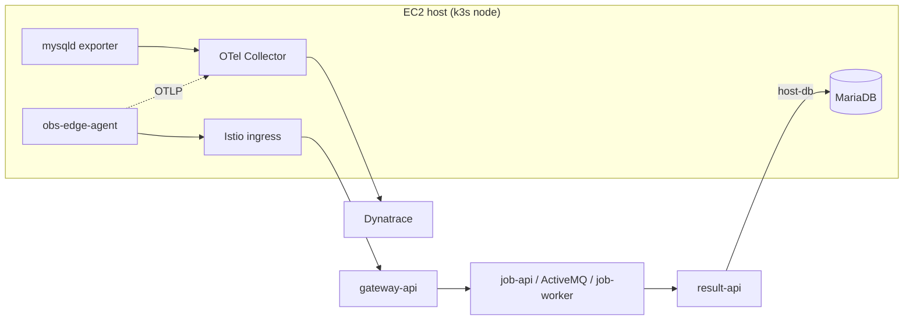

# Host monitoring (EC2)

Shows Dynatrace OpenTelemetry host and process monitoring (`otel:host`, `otel:process`) next to the Kubernetes workload. The Dynakube uses application monitoring only, so no host OneAgent overlaps with the host collector.

```text
EC2 host (k3s node)
  obs-edge-agent (systemd, Go, OTLP) --http--> Istio ingress -> gateway-api -> job-api -> ActiveMQ
                                                                   job-worker -> grpc-service -> result-api (pod)
  MariaDB (native)  <------ host-db Service + EndpointSlice ------ result-api
  prometheus-mysqld-exporter :9104 --scrape--+
  Dynatrace OTel Collector (systemd) <-- OTLP 127.0.0.1:4318 -- obs-edge-agent
     hostmetrics + journald + resource_detection --> Dynatrace
```



## What it shows

- `otel:host` for the EC2 instance from the collector's hostmetrics receivers (`host.id`, `host.name` from the `system` resource detector).
- `otel:process` entities for `obs-edge-agent`, `mariadbd`, `prometheus-mysqld-exporter`, and `dynatrace-otel-collector` (`process.executable.name` is the Linux comm name, hence the 15-character agent name).
- A trace that starts in a native host process, crosses the Istio ingress and the mesh, and ends with `result-api` writing to the host database.
- `obs-edge-agent` logs carrying `trace_id`/`span_id`, and journald logs with `process.executable.name` reduced to the executable basename.
- MariaDB internals (from the mysqld exporter) attached to the `mariadbd` process entity via `process.executable.name=mariadbd`.
- Manual failure: `sudo systemctl stop mariadb` makes `result-api` return 503, so the worker NACKs and redelivers. `sudo systemctl start mariadb` recovers.

## Prerequisites

- Ubuntu/Debian k3s node with Docker, `kubectl` (set `KUBECTL="k3s kubectl"` if needed), `envsubst`, `openssl`, and `curl`, with the Observability Demo workload deployed.
- In Dynatrace, activate the **OpenTelemetry Host Monitoring** extension from Hub.
- A token with `metrics.ingest`, `logs.ingest`, and `openTelemetryTrace.ingest`, as `DT_OTEL_INGEST_TOKEN` in `.env` (falls back to `DT_DATA_INGEST_TOKEN`), plus `DT_TENANT_URL`.
- The EC2 security group must not expose 3306 publicly. MariaDB binds to the node IP for pod access only.

## Install

On the host, from the repository root:

```bash
cp .env.example .env   # set DT_TENANT_URL and DT_OTEL_INGEST_TOKEN
make host-monitoring
```

The script installs MariaDB and the mysqld exporter, downloads and checksum-verifies the Dynatrace OTel Collector (`COLLECTOR_VERSION`, default 0.59.0), builds `obs-edge-agent` with Docker, installs both systemd units, applies `deploy/k8s/host/host-db.yaml.tpl`, and points `result-api` at the database through a `host-db` Secret. Optional overrides: `HOST_DB_IP`, `INGRESS_URL` (default `http://<node IP>`, because the k3s service load balancer usually does not catch traffic to 127.0.0.1; empty means node IP), `JOURNALD_DIRECTORY`, `KUBECTL`. Reruns reuse the stored database passwords in `/etc/obs-demo/host-db.env`.

Check it:

```bash
systemctl status obs-demo-otel-collector obs-edge-agent
journalctl -u obs-edge-agent -f
mysql -e 'SELECT COUNT(*) FROM obs_demo.results'
```

In Dynatrace, DQL such as `fetch dt.entity.otel:host` or `smartscapeNodes "otel_process"` may list the new entities; exact names depend on tenant and extension version.

## Limitations

- MariaDB emits no spans. Dynatrace does not automatically draw an edge from `result-api`'s database call to the `mariadbd` `otel:process`; the link is made by the demo narrative, host, and timing.
- The host collector's hostmetrics overlap with Kubernetes node metrics from the cluster; expect the same machine to appear in both views.
- The journald receiver reads `JOURNALD_DIRECTORY`, which the install script sets to `/var/log/journal` if it exists and `/run/log/journal` otherwise. Override it with the `JOURNALD_DIRECTORY` environment variable.
- Only the install script is provided; remove the units and packages manually.
